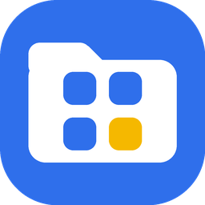

  

  
  
  

  <a href="README.md">English</a> · <b>한국어</b>

---

**Tidy는 폰에 깔린 앱을 알아서 폴더로 정리해 줘요.**
갤럭시 기본 앱스 화면은 다른 앱이 정리할 수 없어서, Tidy는 런처로 만들었어요.
기본 홈 앱으로 써도 되고, 일반 앱처럼 아이콘을 눌러 열어도 돼요.

- **설치하자마자 분류**: 새 앱은 바로 맞는 폴더로 들어가고, 한 번 눌러 바꿀 수 있어요
- **국내 앱도 잘 알아요**: 토스, 배민, 카카오톡 같은 앱과 삼성 기본 앱까지
- **직접 옮긴 앱은 그대로**: 다시 분류해도 바뀌지 않고, 폴더 이름도 바꿀 수 있어요
- **폰 안에서만 처리**: 앱 목록은 어디에도 전송되지 않아요
- **검색과 전체 A–Z 보기**도 있어요
- **한국어·영어**, 폰 언어를 따라가요

## 설치

1. [최신 릴리스](https://github.com/seolcu/tidy/releases/latest/download/tidy.apk)에서 `tidy.apk`를 내려받아요.
2. 파일을 열어요. Play 스토어 앱이 아니라서 처음 한 번은 브라우저나 파일 앱의 '출처를 알 수 없는 앱 설치'를 허용해야 해요.
3. **기본 홈 앱으로 설정**을 고르거나, 홈 화면은 그대로 두고 Tidy 아이콘으로 열어요.

새 버전은 GitHub에서 확인해서 앱 안에서 바로 업데이트할 수 있어요(설정 → 앱 업데이트).

## 빌드

명령어, 구조, 릴리스 방법은 [AGENTS.md](AGENTS.md)에 있어요.

## 라이선스

MIT. Pretendard 글꼴: SIL Open Font License (`third_party/pretendard/`).
